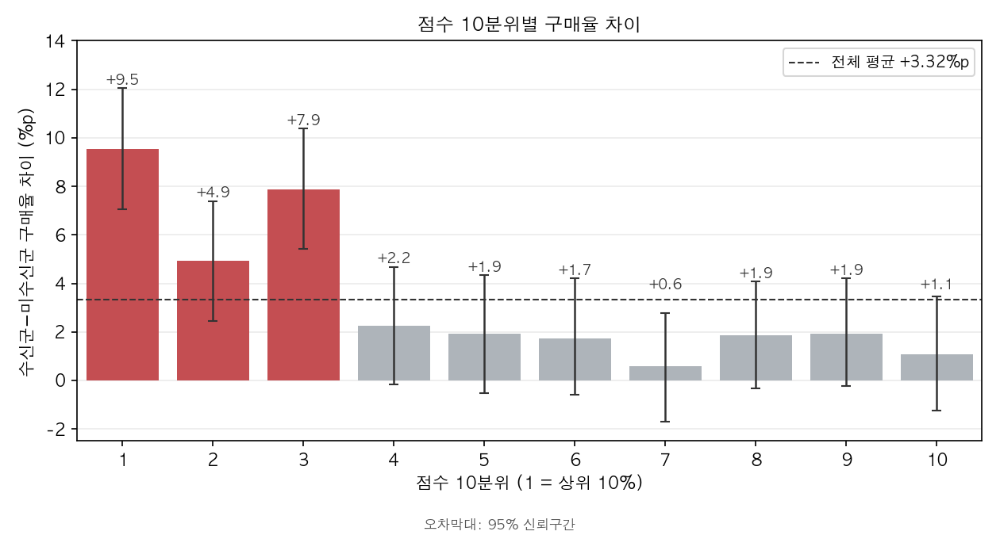
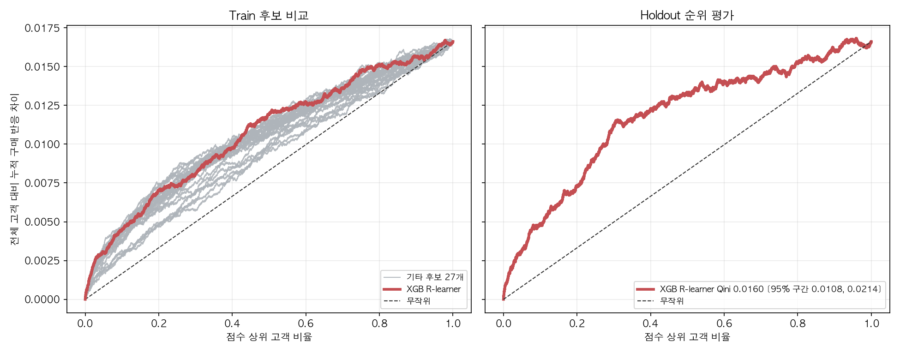
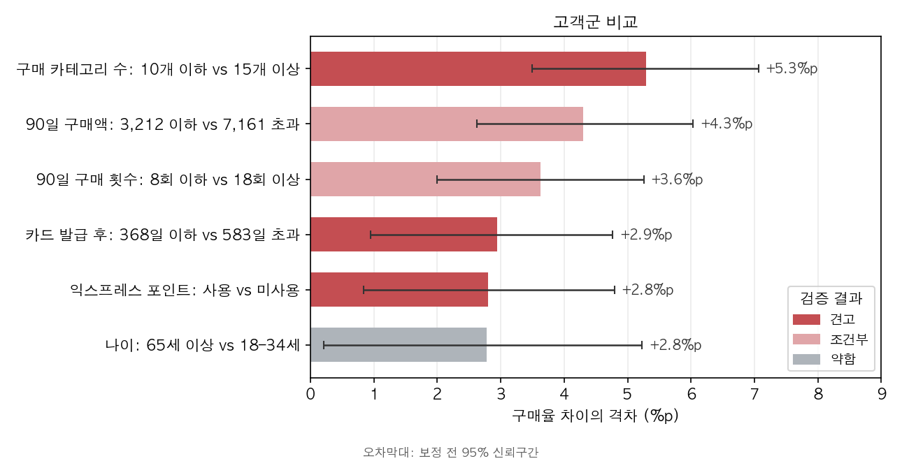
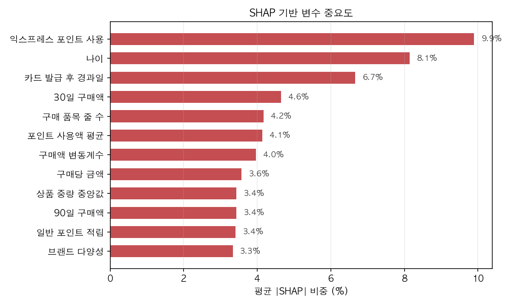

# Uplift 모델링을 활용한 X5 리테일 SMS 캠페인 발송 대상 선정

SMS 발송 대상을 정할 때 구매 가능성이 높은 고객을 고르는 것만으로는 발송에 따른 추가 반응을 알 수 없다. SMS 발송 여부를 무작위로 나눈 X5 RetailHero 캠페인 고객 200,039명과 캠페인 이전 구매 로그 45,786,568행을 이용해, uplift 모델이 수신군·미수신군의 구매율 차이가 큰 고객군을 우선 배치하는지 평가했다.

| holdout에서 관측한 구매율 차이 | holdout Qini | 비교한 후보 |
|---|---|---|
| 상위 30% **+7.37%p** / 전체 +3.32%p (약 **2.2배**) | **0.0160** [0.0108, 0.0214] | 28개 중 1개 선정 |

구매율 차이는 SMS 수신군 − 미수신군 구매율이며, 2.2배는 두 차이의 비율이다. Qini는 고객 순위가 무작위 순위보다 나은 정도를 요약한다.

## 분석 설계와 수행

| 단계 | 수행 내용 |
|---|---|
| 데이터·피처 | 구매 로그 중심으로 테이블을 통합하고 고객 피처 38개의 구성·집계 방식 설계(구매 횟수·금액, 장바구니, 포인트, 카드·인구통계 정보) |
| 입력 검증 | 기준일 이후 정보가 섞인 포인트 최초 사용일 관련 변수 3개를 기준일 이전 정보로 재구성. 처치 여부 예측 AUC 0.5189(원본 변수 포함) → 0.4998(재구성, 무작위 배정이면 0.5) |
| 모델 후보 | XGBoost·LightGBM 2종 × uplift 학습기 7종(S, T, X, R, DR, 4-class, Lai) × 피처 구성 2종(전체 38개, KL 상위 10개) = 28개 후보 설계 |
| 검증·선정 | train 70%에서 nested CV(outer 5 × inner 3)와 Optuna 40회/후보·outer fold로 비교하고, CV 평균 Qini 기준으로 모델 선정 |
| 최종 평가 | 선정 모델을 train 전체로 재튜닝·재학습하고 holdout 30%에서 1회 평가 |

## 주요 결과

### 발송 우선순위 평가

위 그림은 점수 10분위별 수신군−미수신군 구매율 차이와 95% 신뢰구간(오차막대).

* 전체 holdout을 나눈 10분위에서 최상위 10%는 +9.53%p. 수신군·미수신군을 각각 점수 상위 30%로 자른 결과는 +7.37%p로 전체 평균 +3.32%p(63.65% vs 60.33%)보다 큼.
* 그림의 1~3분위 합산값은 +7.44%p로, 군별 상위 30%인 +7.37%p와 집계 방식이 다름.
* 4~10분위는 +0.6%p에서 +2.2%p로 0과 구분되지 않으며, 음수인 분위는 없음.

### 모델 비교와 선정

왼쪽은 train 후보 28개, 오른쪽은 선정 모델의 holdout 곡선. 세로축은 수신군 규모로 보정한 누적 구매 반응 차이를 전체 고객 수로 나눈 값이며, 앞의 구매율 차이(%p)와 단위가 다름.

| 후보 | CV Qini (train outer 5 fold 평균 ± SD) | holdout Qini |
|---|---:|---:|
| **XGBoost R-learner (선정)** | **0.0114 ± 0.0038** | **0.0160** |
| XGBoost X-learner | 0.0114 ± 0.0021 | – |
| LightGBM DR-learner | 0.0113 ± 0.0038 | – |
| LightGBM R-learner | 0.0111 ± 0.0034 | – |
| XGBoost DR-learner | 0.0109 ± 0.0033 | – |

* XGBoost R-learner는 CV 평균 최대 Qini 점수를 바탕으로 선정했지만, 상위 후보 간 점수 차이는 크지 않음(1·2위 차이 0.00006).
* 상위 30% 구매율 차이(uplift@30%)는 CV에서 1위와 선정 모델의 차이(0.56%p)가 fold 간 변동(약 1.0%p)보다 작은 잡음 수준이라 기준으로 쓰지 않음.

### 사후 탐색: 고객군별 구매율 차이

그림의 격차는 두 고객군에서 각각 관측한 수신군−미수신군 구매율 차이를 다시 뺀 값(앞 고객군−뒤 고객군). 막대 색은 검증 결과(견고·조건부·약함)로, 다중비교 보정·대체 척도·다른 변수 통제를 종합한 판정. 막대 끝 구간은 보정 전 95% 신뢰구간.

* **구매 카테고리 수가 적은 고객:** 구매한 카테고리 수가 10개 이하인 고객이 15개 이상보다 +5.3%p 큼.
* **최근 90일 구매액·횟수가 적은 고객:** 최근 90일 기준 구매액 3,212 이하가 7,161 초과보다 +4.3%p, 횟수 8회 이하가 18회 이상보다 +3.6%p 큼. 다만 다른 변수를 함께 통제하면 각각 +0.1%p, +2.0%p로 0과 구분되지 않고, 기본 구매율이 낮아 상승 여지가 더 큰 점과도 구분되지 않음.
* **카드 발급 1.6년(583일) 이하 고객:** 368일 이하가 583일 초과보다 +2.9%p 크며, 368–583일 고객도 368일 이하와 비슷함.
* **익스프레스 포인트 사용 고객:** 사용 고객이 미사용 고객보다 +2.8%p 큼.
* **65세 이상 고객:** 18–34세보다 +2.8%p 크지만 비교 수를 보정하면 0과 구분되지 않음.
* **요약:**
    * SMS 수신 시 구매율 상승 폭이 더 큰 것으로 검증 결과가 견고한 고객군은 (1) **구매 카테고리 10개 이하**, (2) **카드 발급 583일 이하**, (3) **익스프레스 포인트 사용** 고객.
    * 최근 90일 구매액·횟수가 적은 고객은 다른 변수를 통제하면 구분되지 않고, 65세 이상은 비교 수 보정 후 근거가 약함.

위 그림은 최종 모델 uplift 점수에 대한 평균 |SHAP| 비중 상위 12개 변수.

* 최종 모델의 uplift 점수에서 평균 |SHAP| 비중이 큰 변수는 익스프레스 포인트 사용, 나이, 카드 발급 후 경과일 순(9.9%, 8.1%, 6.7%).
* 평균 |SHAP|은 점수에 대한 영향의 크기만 나타냄. 영향의 방향이나 구매 반응의 원인 설명은 아니며, 위의 고객군 비교와 순위가 다를 수 있음.

## 한계점 및 향후 과제

* 한 소매사의 SMS 캠페인 1회 결과이며, 발송일이 공개되지 않아 피처가 캠페인 이전 정보라는 점은 원본 데이터 설명에 기댄 가정.
* 발송 비용과 마진 데이터가 없어 최적 발송 규모나 수익은 산정하지 않음.
* 고객군 비교는 변수끼리 상관돼 있어 각 변수가 원인이라는 뜻은 아님.
* **향후 과제:**
    * 다음 캠페인에서 점수 상위 30%와 나머지 70%에서 각각 발송·미발송을 무작위로 나눠, 상위 30%의 차이가 새 고객에서도 나오는지 확인.
    * 같은 실험에서 (1) 구매 카테고리 10개 이하, (2) 카드 발급 583일 이하, (3) 익스프레스 포인트 사용 여부로 층을 나눠 무작위 배정하고, 해당 고객군의 구매율 상승 폭이 비해당 고객보다 큰지 사전에 정한 가설로 검증.

## 코드와 재현

Python · pandas · XGBoost · LightGBM · Optuna · scikit-uplift

| 경로 | 내용 |
|---|---|
| [code/README.md](code/README.md) | 단계별 노트북 읽기 순서와 원본 입력·실행 범위 |
| [code/notebooks/](code/notebooks/) | 데이터·피처, 모델 선정, holdout 평가, 사후 고객군 분석 |
| [code/modeling/](code/modeling/) | 피처 생성, 입력 점검, 분할, 튜닝, 선정, 최종 평가, 분석·그림 스크립트 |
| [code/evidence/](code/evidence/) | 입력 점검, 선정표, holdout 평가, 분위·고객군 분석 결과 파일 |
